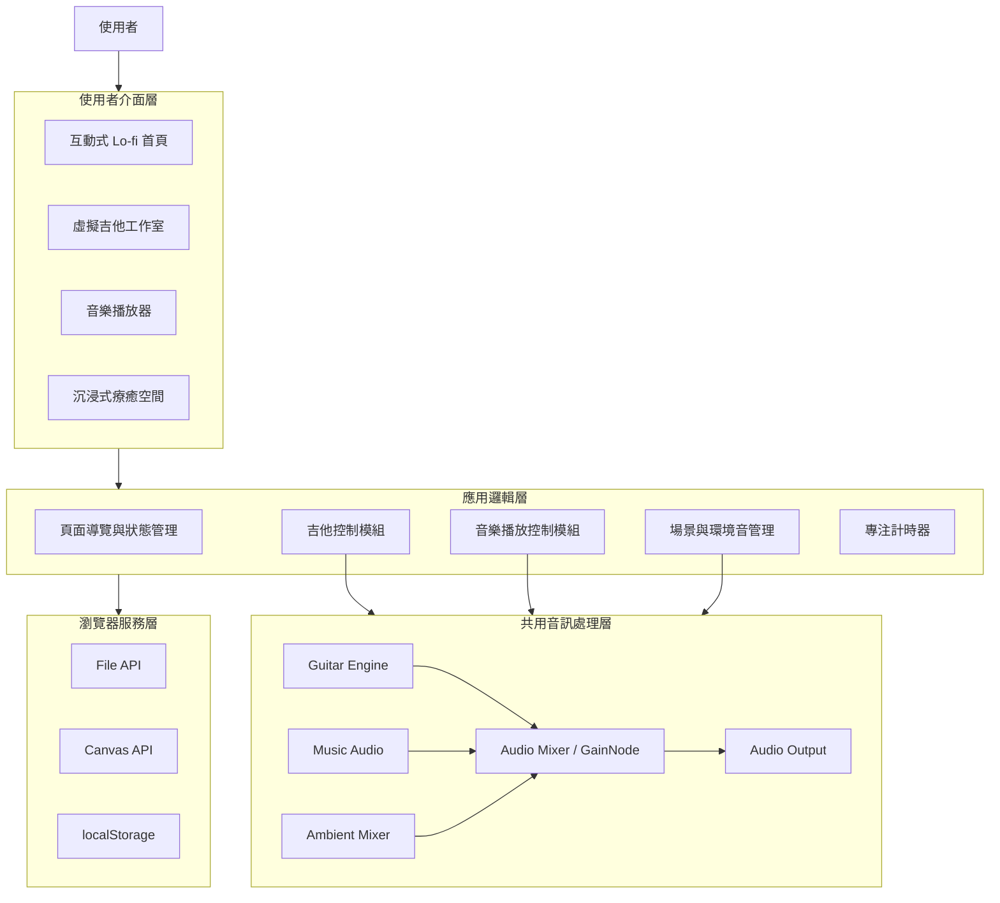
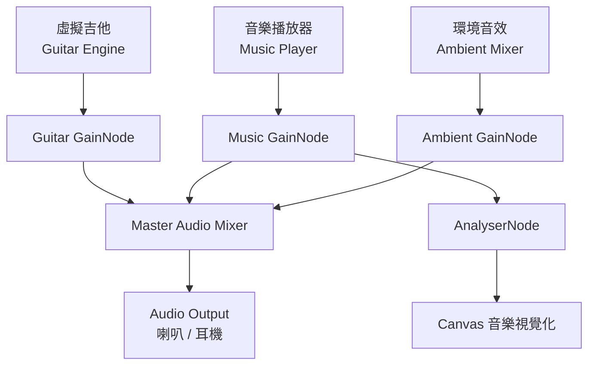
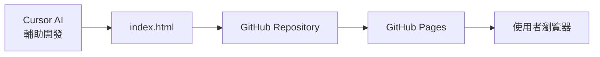

# 🎸 Echo Room
### 迴響之間｜沉浸式互動音樂工作室

**專案類型：** 互動式音樂 Web App  
**開發方式：** Vibe Coding（Cursor AI 輔助開發）  
**開發技術：** HTML5、CSS3、JavaScript、Web Audio API、Canvas API  
**部署平台：** GitHub Pages

---

## 一、專案背景

隨著數位音樂與網頁技術的發展，使用者可以透過網路聆聽音樂、體驗虛擬樂器及播放自然環境音。然而，目前多數音樂相關網站以單一功能為主，例如音樂播放器主要提供歌曲播放、虛擬樂器網站著重樂器操作，而療癒音效網站則提供雨聲、海浪等環境音，使用者若想同時體驗不同功能，通常需要切換多個網站。

此外，一般音樂網站大多採用傳統播放器或清單式介面，較缺乏具有情境氛圍的視覺設計與互動體驗。因此，本專案希望突破傳統音樂網站的呈現方式，將音樂創作、音樂欣賞與環境療癒整合於同一個平台，打造兼具娛樂性、實用性與沉浸感的互動式音樂空間。

## 二、開發動機與目的

本專案以「打造一個專屬於自己的音樂空間」為核心理念，結合個人對音樂及創意網頁設計的興趣，希望透過 Vibe Coding 的方式，運用 AI 輔助開發一個具有高質感視覺效果與實際互動功能的網站。

不同於一般僅能觀看或聆聽的音樂網站，Echo Room 希望讓使用者能夠主動參與音樂體驗。使用者可以透過虛擬吉他彈奏旋律、播放自己喜歡的歌曲，並自由搭配雨聲、海浪或森林等環境音，創造符合當下心情的音樂氛圍。

在介面設計方面，網站以日系 Lo-fi 音樂房間為主要視覺，融合深色系、玻璃擬態、霓虹燈光及動態音樂視覺化，讓使用者不只是操作功能，而是彷彿進入一間可以自由探索的音樂工作室。

本專案主要希望達成以下目的：

1. **整合多元音樂功能：** 將虛擬吉他、音樂播放器及療癒環境音整合於同一個網站，減少使用者切換不同平台的需求。
2. **提升互動體驗：** 透過琴弦彈奏、和弦切換、音樂視覺化及場景互動，讓使用者能夠實際參與音樂創作與操作。
3. **打造個人化療癒空間：** 提供不同的沉浸式場景與環境音混音功能，讓使用者依照心情、讀書或休息需求自由調整。
4. **實踐 AI 輔助網頁開發：** 透過 Cursor 進行需求規劃、程式實作、功能測試與持續優化，體驗 Vibe Coding 的完整開發流程。

---

## 三、系統功能介紹

Echo Room 主要整合三大核心功能，並透過互動式首頁與共用音訊系統，讓各項功能能夠互相配合。

### 3.1 互動式 Lo-fi 音樂房間

網站首頁以日系 Lo-fi 音樂房間為設計主題，結合雨夜窗景、吉他、黑膠唱片機、桌燈及柔和的環境光，營造溫暖且具有沉浸感的音樂空間。

使用者可以直接點擊房間中的物件，進入不同功能：

| 互動物件 | 功能說明 |
|---|---|
| 🎸 吉他 | 點擊後進入虛擬吉他工作室 |
| 💿 黑膠唱片機 | 點擊後開啟音樂播放器 |
| 🌧️ 窗戶 | 點擊後進入沉浸式療癒空間 |
| 💡 桌燈 | 點擊後切換房間燈光效果 |

透過物件互動取代傳統的單純選單操作，增加網站的探索性與趣味性。

### 3.2 虛擬吉他音樂工作室（Virtual Guitar Studio）

提供可實際操作的虛擬吉他，讓使用者透過滑鼠、鍵盤或觸控方式進行彈奏。

**主要功能：**

- **虛擬琴弦彈奏：** 模擬六條吉他琴弦，點擊不同琴弦可以發出對應音高。
- **鍵盤操作：** 使用 A、S、D、F、G、H 按鍵控制六條琴弦。
- **和弦切換：** 提供 C、G、D、Am、Em、F 等常見吉他和弦，並顯示對應指法。
- **演奏錄製：** 記錄使用者彈奏的音符與時間，支援重新播放。
- **彈奏動畫：** 琴弦被撥動時產生震動、光暈及音符粒子效果。

系統利用 Web Audio API 產生琴弦聲音，讓使用者不需要實體樂器，也能透過瀏覽器體驗簡單的吉他彈奏。

### 3.3 沉浸式音樂播放器（Music Player）

提供完整的音樂播放功能，使用者可以上傳電腦中的音樂檔案，建立個人播放清單。

**主要功能：**

- **本機音樂上傳：** 支援 MP3、WAV 等瀏覽器可播放的音訊格式。
- **播放控制：** 提供播放、暫停、上一首、下一首、進度調整及音量控制。
- **播放清單：** 顯示已加入的歌曲，支援切換與移除。
- **播放模式：** 提供隨機播放及循環播放功能。
- **音樂視覺化：** 利用音訊分析技術，將音樂轉換為動態頻譜、圓形音波或粒子動畫。
- **全站持續播放：** 使用者切換至吉他工作室或療癒空間時，音樂仍可持續播放。

透過 Web Audio API 與 Canvas API，讓音樂不只是聲音，也能以動態視覺方式呈現。

### 3.4 沉浸式療癒空間（Ambient Space）

提供多種具有不同氛圍的虛擬場景，讓使用者依照心情自由選擇，搭配音樂與環境音建立專屬的放鬆空間。

**場景設計：**

| 場景 | 視覺特色 | 搭配環境音 |
|---|---|---|
| 🌧️ Rainy Night | 雨夜窗景、城市霓虹、雨滴動畫 | 雨聲、雷聲 |
| 🌲 Forest Cabin | 森林小屋、暖色燈光、漂浮光點 | 森林、風聲 |
| 🌊 Ocean Sunset | 海邊夕陽、海浪動畫、漸層天空 | 海浪、海風 |
| 🌌 Starry Sky | 星空、流星、銀河光暈 | 微風、柔和環境音 |

**主要功能：**

- **場景自由切換：** 點擊不同場景即可改變背景、燈光與動畫效果。
- **環境音混音：** 提供雨聲、雷聲、海浪、森林、壁爐及風聲等音效，可同時播放並獨立調整音量。
- **專注計時器：** 提供 25 分鐘專注、5 分鐘休息及自訂時間功能。
- **沉浸模式：** 隱藏部分操作介面，讓使用者專注於音樂與場景氛圍。

例如，使用者可以選擇雨夜場景，播放喜歡的 Lo-fi 音樂，同時將雨聲調整為 60%，營造適合讀書或放鬆的環境。

### 3.5 跨功能整合

Echo Room 最大的特色在於三大功能並非獨立運作，而是透過共用音訊系統相互整合。

使用者可以同時：

1. 播放自己上傳的音樂。
2. 使用虛擬吉他彈奏旋律。
3. 開啟雨聲、海浪等環境音。
4. 切換不同的沉浸式場景。
5. 調整各種聲音的音量。

例如，在 Rainy Night 場景中，使用者可以一邊播放背景音樂，一邊聆聽雨聲並彈奏吉他，形成結合視覺、聽覺與操作的沉浸式音樂體驗。

---

## 四、系統架構

### 4.1 系統整體架構

本系統採用 **Client-Side Single Page Application（SPA，客戶端單頁式應用程式）** 架構，所有主要功能皆在瀏覽器端執行，不需要額外建立後端伺服器或資料庫。

網站以 HTML5 建立頁面結構、CSS3 負責介面設計與動畫，JavaScript 處理功能邏輯，並透過 Web Audio API 整合音樂播放、吉他發聲與環境音混音。

系統架構分為四個主要層級：

**第一層：使用者介面層（Presentation Layer）**

負責顯示互動式首頁、吉他工作室、音樂播放器及療癒空間，並接收使用者操作。

**第二層：應用邏輯層（Application Logic Layer）**

負責處理頁面切換、吉他彈奏、音樂播放控制、場景管理、環境音設定及計時器等功能。

**第三層：音訊處理層（Audio Processing Layer）**

透過 Web Audio API 統一管理吉他聲音、音樂播放器及環境音，並利用 GainNode 控制音量、AnalyserNode 分析音訊資料。

**第四層：瀏覽器服務層（Browser Services Layer）**

使用 File API 讀取本機音樂、Canvas API 繪製音樂視覺化效果，並透過 localStorage 保存使用者偏好設定。

### 4.2 系統架構圖

### 4.3 系統技術架構

| 技術 | 應用功能 | 說明 |
|---|---|---|
| HTML5 | 網頁結構 | 建立首頁、吉他、播放器及療癒空間介面 |
| CSS3 | 視覺設計 | 玻璃擬態、霓虹光暈、動畫與響應式版面 |
| JavaScript | 系統邏輯 | 頁面切換、事件處理及功能控制 |
| Web Audio API | 音訊處理 | 吉他發聲、音樂混音及音量管理 |
| Canvas API | 動態視覺化 | 音樂頻譜、音波及粒子動畫 |
| File API | 音樂上傳 | 讀取使用者選擇的本機音樂 |
| localStorage | 偏好設定 | 保存場景、音量及部分使用者設定 |
| GitHub Pages | 網站部署 | 提供公開的靜態網站存取服務 |

### 4.4 核心音訊架構

為了讓虛擬吉他、音樂播放器及環境音能夠同時運作，系統設計共用的 Audio Engine，集中管理不同音訊來源。

各音源透過獨立的 GainNode 控制音量，再由共用混音系統輸出聲音。

音樂播放器的音訊另外連接至 AnalyserNode，取得頻率資料後交由 Canvas API 繪製動態視覺效果。

此架構可以讓使用者在播放音樂的同時彈奏吉他，並搭配不同的環境音，而不需要切換或停止原本的音訊。

### 4.5 網站部署架構

本專案使用單一 `index.html` 整合所有 HTML、CSS 與 JavaScript 程式碼，並透過 GitHub Pages 部署。

由於所有核心功能皆在瀏覽器端執行，因此不需要另外架設後端伺服器或資料庫。使用者只需要透過 GitHub Pages 網址，即可開啟網站並使用相關功能。

---

## 五、預期成果

本專案預期完成一個整合虛擬吉他、音樂播放器與沉浸式療癒空間的互動式網站。

使用者可以透過具有日系 Lo-fi 風格的互動房間探索不同功能，自由彈奏吉他、播放個人音樂，並搭配不同的環境音及場景動畫，建立符合自身需求的音樂空間。

在技術方面，透過 Web Audio API 整合多種音訊來源，搭配 Canvas API 與 CSS 動畫實現動態視覺效果，並以單一 HTML 檔案完成網站開發及 GitHub Pages 部署。

透過本次 Vibe Coding 實作，希望學習如何將創意構想轉換為具體的功能需求，並利用 AI 輔助完成程式開發、介面設計、功能整合與測試優化。

**Echo Room — Your Music, Your Space.**

讓音樂不只是被聆聽，而是成為一個可以親自探索的空間。